# Lenz — AI-Powered Intelligent Video Surveillance

  <strong>Turning Every Camera into an Intelligent Guardian</strong>

  Transforming ordinary CCTV cameras into intelligent,
  AI-powered monitoring systems for safer and smarter environments.

  🚨 Threat Detection • 👥 Crowd Monitoring • 🚗 Parking Intelligence • 📊 Real-Time Insights

---

## Table of Contents

1. [Problem Statement](#1-problem-statement)
2. [Problem Understanding & Approach](#2-problem-understanding--approach)
3. [Proposed Solution](#3-proposed-solution)
4. [Key Features](#4-key-features)
5. [System Architecture](#5-system-architecture)
6. [System Workflow](#6-system-workflow)
7. [AI & Computer Vision Approach](#7-ai--computer-vision-approach)
8. [Technology Stack](#8-technology-stack)
9. [Database Design](#9-database-design)
10. [Dataset & Model Selection](#10-dataset--model-selection)
11. [API Documentation & Testing](#11-api-documentation--testing)
12. [Installation & Setup](#12-installation--setup)
13. [End-to-End Workflow](#13-end-to-end-workflow)
14. [Demo & Screenshots](#14-demo--screenshots)
15. [Module-Wise Development](#15-module-wise-development)
16. [Team Roles & Responsibilities](#16-team-roles--responsibilities)
17. [Future Scope](#17-future-scope)
18. [Known Limitations](#18-known-limitations)
19. [Privacy & Responsible AI](#19-privacy--responsible-ai)
20. [Impact](#20-impact)

---

## 1. Problem Statement

### Problem Title

**AI-Powered Intelligent Video Surveillance & Real-Time Threat Detection**

### Problem Description

Millions of CCTV cameras are installed across restaurants, railway
stations, classrooms, hospitals, shopping malls, parking areas,
offices, and public streets.

These cameras continuously record video footage, but most surveillance
systems still depend heavily on human operators to monitor camera feeds
and identify important events.

With multiple cameras recording simultaneously, it becomes difficult
for security personnel to observe every feed continuously.
As a result, theft, suspicious activities, parking violations,
and overcrowded areas may go unnoticed until someone manually
reviews the footage or reports an incident.

Traditional CCTV systems primarily act as recording devices rather
than intelligent monitoring systems.

The problem is not the lack of cameras, but the lack of intelligence
in the information they capture.

Lenz aims to bridge this gap by using Artificial Intelligence (AI)
and Computer Vision to analyse video feeds, identify predefined
events, and generate actionable alerts for security personnel.

The goal is to transform existing camera infrastructure into
an intelligent monitoring system that helps people identify
potential problems faster and make informed decisions.

---

### Key Challenges

| Challenge | Description | Impact |
|---|---|---|
| **Continuous Manual Monitoring** | Security personnel must observe multiple camera feeds simultaneously. | Important incidents may be missed. |
| **Delayed Theft Detection** | Suspicious activities may remain unnoticed until footage is reviewed. | Delayed response and potential losses. |
| **Crowd Management** | Operators may struggle to estimate crowd density across multiple locations. | Overcrowding and delayed intervention. |
| **Parking Violations** | Unauthorized parking and occupied spaces may not be monitored efficiently. | Congestion and inefficient parking management. |
| **Information Overload** | Cameras generate large volumes of footage throughout the day. | Reviewing recordings consumes time and effort. |
| **Delayed Incident Response** | Conventional systems may require someone to notice an incident before action is taken. | Slower security response. |
| **Limited Actionable Insights** | Raw video footage does not automatically provide structured event summaries. | Difficult monitoring and decision-making. |
---

## 3. Target Users

The **Lenz AI Surveillance System** is designed for organizations that already use CCTV cameras and want to improve security monitoring, crowd management, and incident response through AI-powered video analysis.

### Target User Flowchart

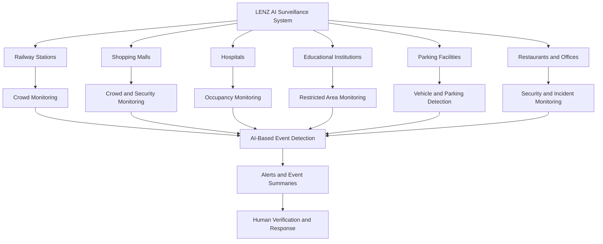

### Project Objectives

| Parameter | Description |
|---|---|
| **Primary Objective** | Improve CCTV monitoring through AI-assisted video analysis and event detection. |
| **Stampede Prevention** | Estimate crowd density in supported camera views to assist with crowd management. |
| **Security Monitoring** | Identify predefined security-related events for human review. |
| **Occupancy Monitoring** | Help facility more efficiently and support faster, more informed responses. |

## Existing Gap vs LENZ AI Improvement

The following comparison illustrates the intended capabilities of traditional CCTV monitoring and the proposed LENZ AI Surveillance System. Scores are illustrative design targets, not measured benchmark results.

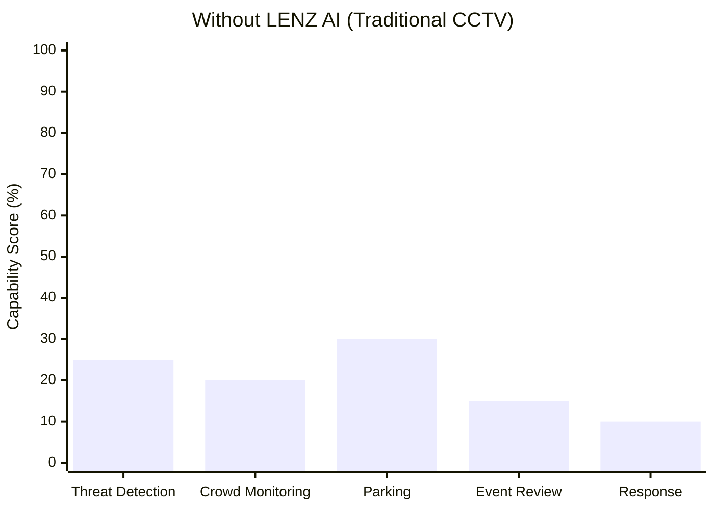

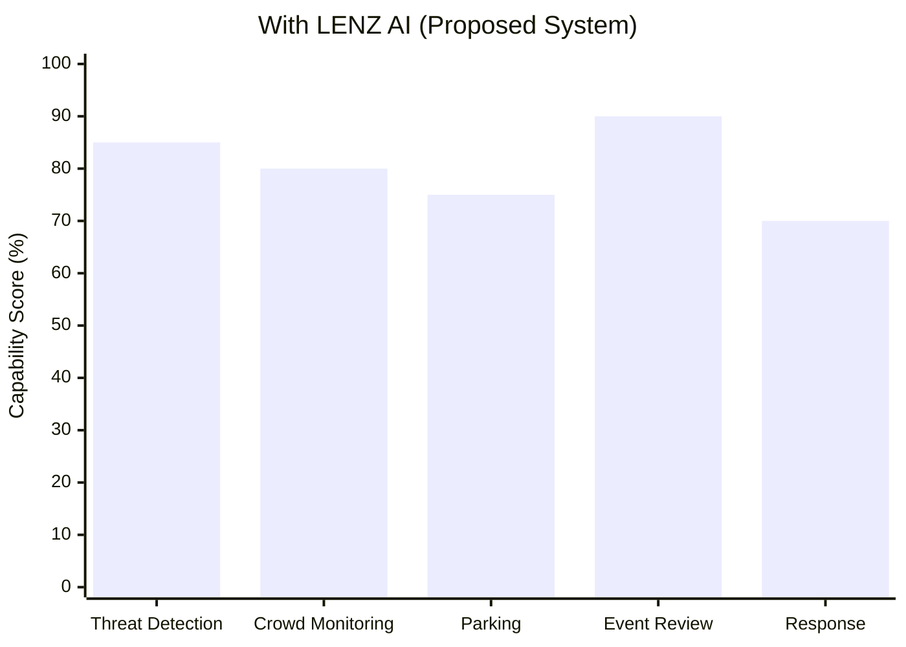

### Existing System Limitations vs Impact of LENZ AI

| Limitation in Existing Systems | Impact on Security Teams and Facility Managers |
|---|---|
| **Continuous manual CCTV monitoring** | Operators must watch multiple camera feeds, increasing workload and the possibility of missing important events. |
| **Delayed incident detection** | Suspicious activities may be noticed only after an incident occurs or someone reports it. |
| **Manual crowd monitoring** | Estimating crowd density manually makes it difficult to identify overcrowding early in supported camera views. |
| **Manual parking surveillance** | Parking violations may go unnoticed when staff cannot continuously monitor every parking area. |
| **Time-consuming footage review** | Security personnel may need to search long video recordings to locate a specific incident. |
| **Limited real-time operational insights** | Facility managers may lack timely information about crowd levels, occupancy, and predefined security events. |
| **Fragmented incident response** | Staff may need to switch between camera feeds, reports, and communication channels to investigate an incident. |

### How LENZ AI Improves the Existing System

| LENZ AI Capability | Expected Operational Benefit |
|---|---|
| **AI-Assisted Threat Detection** | Identifies predefined suspicious activities or security-related events supported by the selected model. |
| **Crowd Density Estimation** | Helps operators monitor crowd levels and identify potential overcrowding in supported camera views. |
| **Parking Violation Detection** | Detects predefined parking violations when the camera view and detection model support the relevant conditions. |
| **Event-Based Video Summaries** | Helps operators locate relevant footage without manually reviewing every recording. |
| **Automated Alerts** | Notifies authorized personnel when configured detection rules are triggered. |
| **Human Verification** | Allows security personnel to review alerts before taking action. |
| **Centralized Monitoring** | Helps operators manage supported camera feeds, alerts, and incident information from one interface. |

## 1. System Workflow

LENZ transforms conventional CCTV infrastructure into an AI-assisted surveillance system. It processes supported camera feeds, analyzes video frames, detects predefined events, and provides alerts and summaries to help security personnel make informed decisions.

### System Workflow Diagram

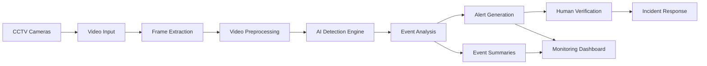

## 2. Problem Understanding & Approach

### Root Cause Analysis

| Problem Area | Root Cause | Impact |
|---|---|---|
| Manual CCTV Monitoring | Operators cannot continuously watch every camera. | Important incidents may go unnoticed. |
| Delayed Threat Detection | Suspicious activities are identified late. | Slower emergency response. |
| Crowd Monitoring | Crowd density is not automatically analyzed. | Overcrowding and safety risks. |
| Parking Violations | Vehicle activity requires manual observation. | Inefficient parking management. |
| Poor Video Analysis | Large amounts of footage require manual review. | Time-consuming investigations. |
| Limited Real-Time Insights | Traditional CCTV primarily records footage. | Reactive rather than proactive security. |

### Root Cause Flowchart

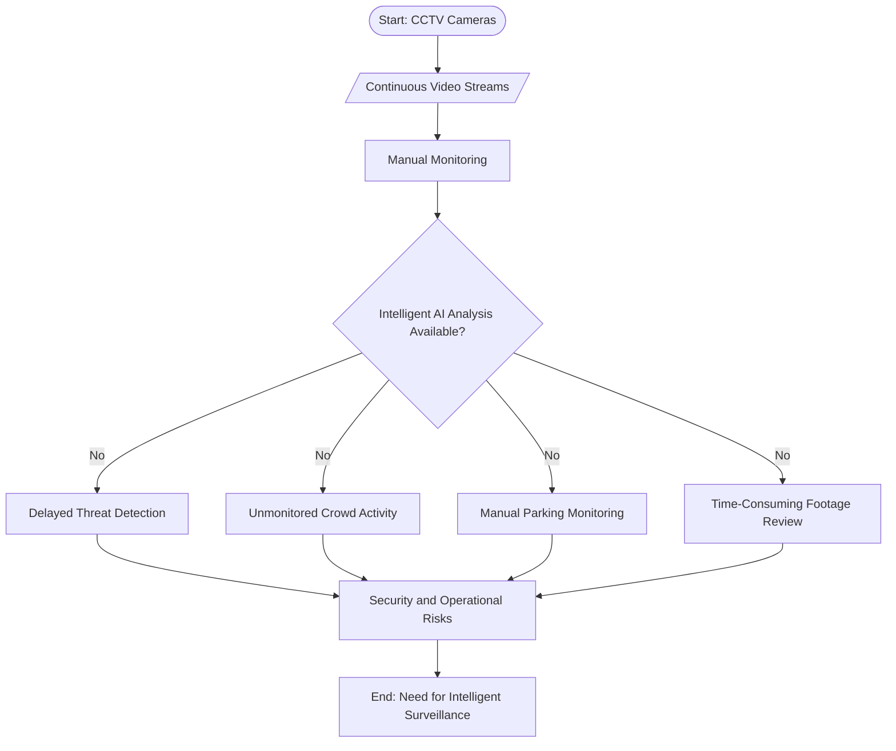

### Solution Strategy

1. **Video Ingestion:** Connect existing CCTV cameras and receive video streams.
2. **AI Video Analysis:** Analyze supported camera feeds using computer vision.
3. **Threat Detection:** Identify predefined suspicious activities and potential safety incidents.
4. **Crowd Monitoring:** Estimate crowd density and detect overcrowding in supported views.
5. **Parking Intelligence:** Detect predefined parking violations and unauthorized parking.
6. **Alerts and Dashboard:** Display relevant alerts, event summaries, and monitoring insights.
7. **Human Verification:** Allow authorized personnel to review alerts and decide appropriate actions.

---

## 3. Proposed Solution

LENZ transforms existing CCTV infrastructure into an intelligent monitoring system that helps security teams identify important events faster.

### Core Solution Components

| Component | Function | Benefit |
|---|---|---|
| Video Ingestion | Receives CCTV video streams. | Centralized monitoring. |
| AI Analysis Engine | Analyzes video for supported events. | Automated event detection. |
| Threat Detection | Identifies predefined suspicious activities. | Faster security response. |
| Crowd Monitoring | Estimates crowd density. | Better crowd management. |
| Parking Intelligence | Detects predefined parking violations. | Improved parking management. |
| Alert System | Generates event-based notifications. | Faster incident awareness. |
| Dashboard | Displays alerts and monitoring insights. | Easier supervision. |
| Human Verification | Enables authorized staff to review events. | More responsible decision-making. |

### Proposed Solution Flowchart

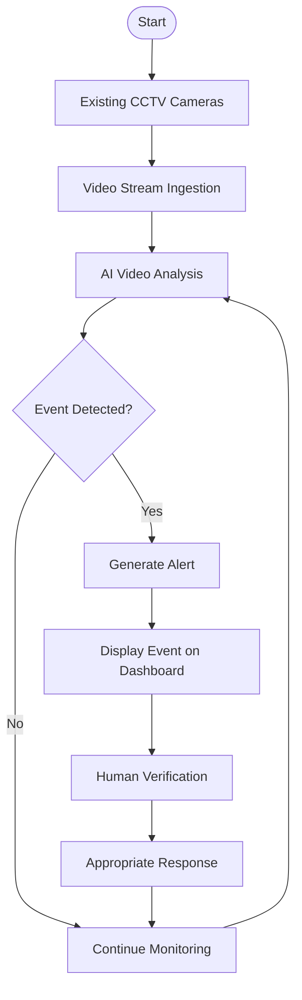

---

## 4. Key Features

| Feature | Description |
|---|---|
| Intelligent Threat Detection | Identifies supported suspicious activities. |
| Crowd Monitoring | Estimates crowd density and highlights overcrowding. |
| Parking Intelligence | Detects predefined parking violations. |
| Real-Time Alerts | Notifies authorized personnel about detected events. |
| Event Summaries | Organizes important incidents for easier review. |
| Centralized Dashboard | Provides a unified monitoring interface. |
| Multi-Location Support | Designed for different CCTV-enabled facilities. |
| Human-in-the-Loop | Keeps security personnel involved in incident verification. |

### Feature Workflow

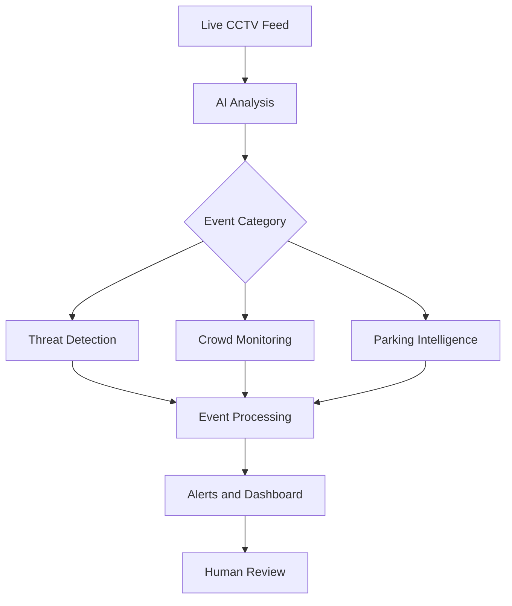

---

## 5. System Architecture

LENZ follows a modular architecture connecting CCTV feeds, video processing, AI inference, event management, and a centralized dashboard.

### Architecture Components

| Layer | Responsibility |
|---|---|
| Camera Layer | Supplies video from existing CCTV cameras. |
| Ingestion Layer | Receives and prepares video streams. |
| Processing Layer | Extracts frames and prepares data for analysis. |
| AI Layer | Performs supported computer vision tasks. |
| Event Layer | Processes detections and creates event records. |
| Notification Layer | Delivers alerts through configured channels. |
| Application Layer | Displays events, summaries, and camera information. |
| Security Layer | Controls access and protects sensitive information. |

### Architecture Diagram

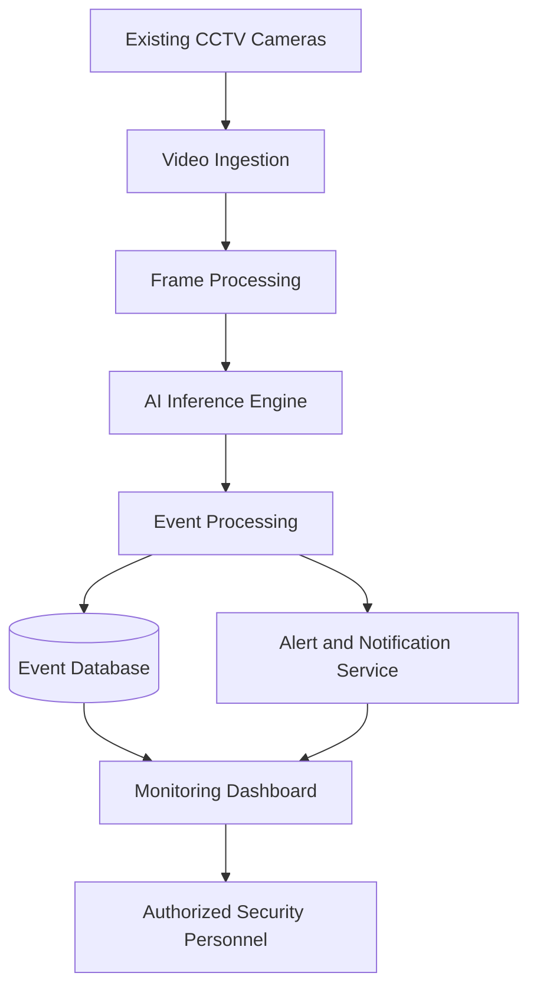

---

## 6. System Workflow

### End-to-End Workflow

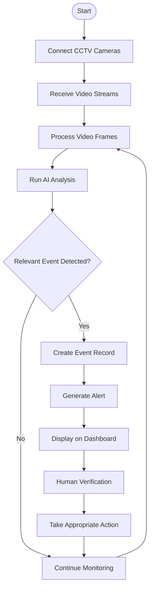

---

## 7. AI & Computer Vision Approach

The system uses computer vision to analyze supported video events and assist security personnel.

| AI Task | Purpose |
|---|---|
| Object Detection | Identifies supported objects in video frames. |
| Person Detection | Detects people in supported camera views. |
| Crowd Estimation | Estimates the number or density of people. |
| Activity Analysis | Identifies predefined activities when supported by the selected model. |
| Vehicle Detection | Identifies vehicles for parking-related analysis. |
| Event Classification | Categorizes detected events for dashboard display. |

### AI Processing Flowchart

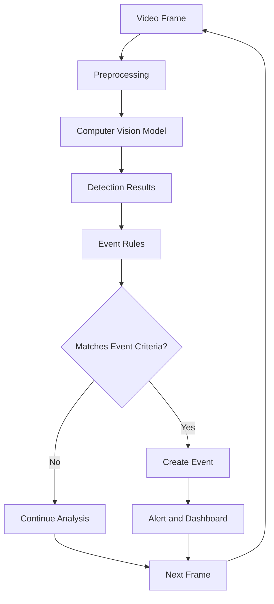

---

## 8. Technology Stack

| Layer | Technology / Requirement |
|---|---|
| Video Input | Existing CCTV cameras and supported video streams. |
| Computer Vision | A suitable object detection or activity analysis model. |
| Backend | API service for video events and application logic. |
| Frontend | Web-based monitoring dashboard. |
| Database | Storage for authorized users, event metadata, and logs. |
| Notifications | Configured alert delivery mechanism. |
| Deployment | Environment suitable for the selected AI model and video workload. |

*Note: Final technologies should reflect the libraries, models, and infrastructure actually implemented in the project.*

---

## 9. Database Design

The database stores application information and event metadata rather than requiring every video frame to be stored permanently.

### Main Entities

| Entity | Purpose |
|---|---|
| Users | Stores authorized user information. |
| Cameras | Stores camera configuration and location details. |
| Events | Stores detected event metadata and timestamps. |
| Alerts | Stores notifications associated with events. |
| Activity Logs | Records relevant system and user actions. |

### Entity Relationship Flowchart

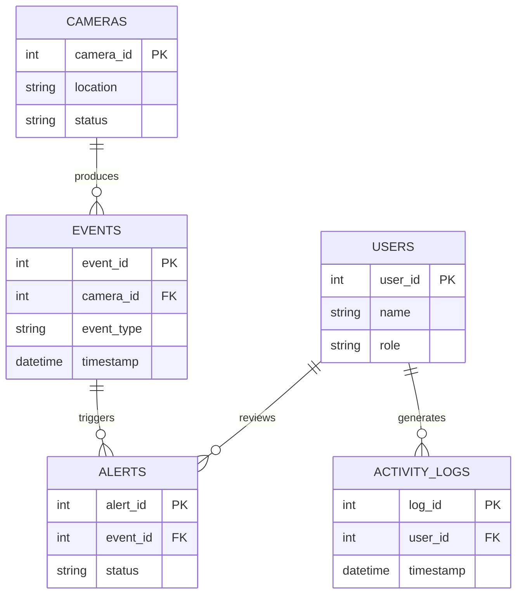

---

## 10. Dataset & Model Selection

| Requirement | Approach |
|---|---|
| Person and Vehicle Detection | Select a suitable object detection model. |
| Crowd Analysis | Use a suitable crowd estimation or density analysis method. |
| Activity Recognition | Evaluate an appropriate model against the required activities. |
| Model Evaluation | Test precision, recall, false alarms, and inference speed. |
| Deployment Selection | Consider available computing resources and camera workload. |

Model selection should be based on actual testing with representative camera footage. Performance must not be assumed without evaluation.

---

## 11. API Documentation & Testing

### Proposed API Endpoints

| Method | Endpoint | Purpose |
|---|---|---|
| GET | `/api/cameras` | Retrieve configured cameras. |
| GET | `/api/events` | Retrieve event records. |
| GET | `/api/alerts` | Retrieve generated alerts. |
| GET | `/api/health` | Check service health. |
| PATCH | `/api/alerts/:id` | Update an alert's review status. |

These are proposed endpoints and should be adjusted to match the implemented backend.

### Testing Strategy

- **Video Input Testing:** Verify that supported streams can be accessed.
- **Detection Testing:** Evaluate the model on representative footage.
- **Alert Testing:** Confirm that qualifying events create the expected alerts.
- **Dashboard Testing:** Verify that events and statuses display correctly.
- **Performance Testing:** Measure processing speed and end-to-end latency.
- **Security Testing:** Verify access control and protection of sensitive data.

---

## 12. Installation & Setup

1. Clone the repository.
2. Install the project's dependencies.
3. Configure environment variables.
4. Configure the database, if required.
5. Connect a supported CCTV stream or test video.
6. Start the backend and frontend services.
7. Open the dashboard and verify the event workflow.

Use the actual installation commands and configuration variables from the project source code.

---

## 13. End-to-End Workflow

### From Camera to Response

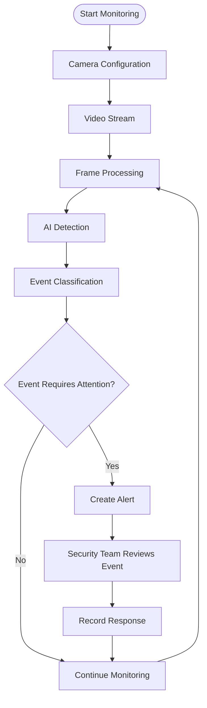

---

## 14. Module-Wise Development

| Module | Main Responsibility |
|---|---|
| Module 1: Video Ingestion | Connect and process supported camera feeds. |
| Module 2: AI Detection | Detect supported objects and activities. |
| Module 3: Event Management | Store and categorize detected events. |
| Module 4: Alert System | Generate and manage notifications. |
| Module 5: Dashboard | Display camera status, alerts, and event history. |
| Module 6: Security & Testing | Implement access control and validate system behavior. |

### Development Workflow

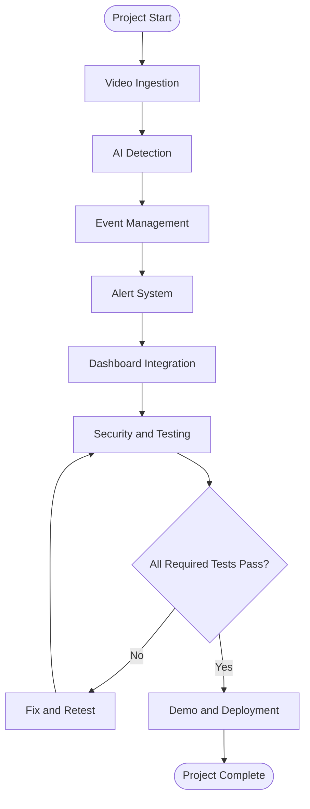

---

## 15. Future Scope

- Integration with additional CCTV systems.
- Improved detection of predefined security incidents.
- Better crowd-density estimation.
- Configurable alerts and escalation rules.
- Searchable event history and video summaries.
- Edge AI deployment for reduced network dependency.
- Privacy-aware processing and configurable video retention.
- Multi-site monitoring with role-based access control.

---

## 16. Responsible AI & Privacy

- Restrict access to authorized personnel.
- Use video footage only for legitimate monitoring purposes.
- Apply appropriate data retention and deletion policies.
- Minimize unnecessary storage of sensitive video data.
- Provide human verification before consequential action.
- Evaluate false positives and false negatives.
- Do not treat an AI-generated alert as proof that a person committed a crime.

---

## 17. Expected Impact

| Area | Expected Benefit |
|---|---|
| Security Monitoring | Faster identification of supported events. |
| Incident Response | Reduced time spent locating relevant incidents. |
| Crowd Management | Better visibility into overcrowding. |
| Parking Management | More efficient detection of predefined violations. |
| Staff Productivity | Less dependence on continuous manual observation. |
| Facility Operations | Centralized event monitoring and reporting. |

Actual improvements should be measured during testing rather than presented as guaranteed results.

---

## 18. Conclusion

LENZ AI Surveillance System aims to transform conventional CCTV infrastructure into an intelligent monitoring platform. By combining computer vision, event-based alerts, centralized dashboards, and human verification, it can help organizations improve situational awareness, manage crowds, identify supported security incidents, and respond more efficiently.
