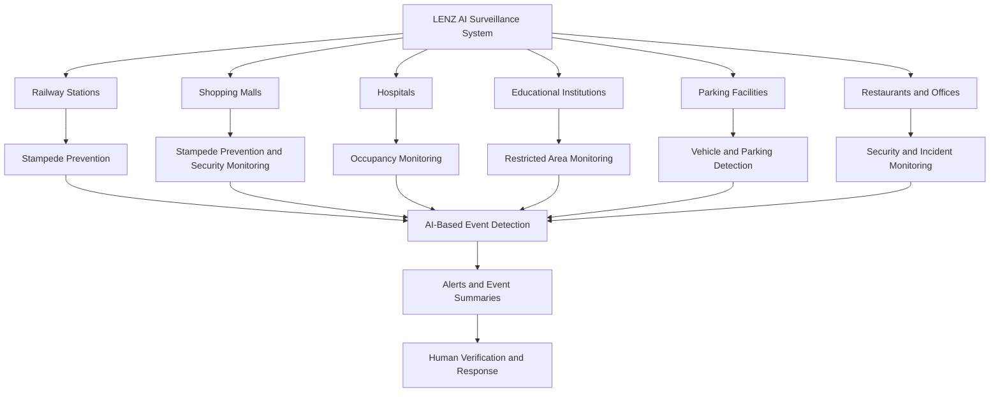
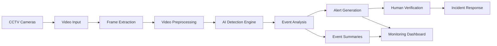

# Lenz — AI-Powered Intelligent Video Surveillance

  <strong>Turning Every Camera into an Intelligent Guardian</strong>

  Transforming ordinary CCTV cameras into intelligent,
  AI-powered monitoring systems for safer and smarter environments.

  Threat Detection • Stampede Prevention • Parking Intelligence • Real-Time Insights

---

## Table of Contents

1. [Problem Statement](#1-problem-statement)
2. [Proposed Solution](#2-proposed-solution)
3. [Target Users](#3-target-users)
4. [System Workflow](#4-system-workflow)
5. [AI & Computer Vision Approach](#5-ai--computer-vision-approach)
6. [Tech](#6-tech)
7. [Database Design](#7-database-design)
8. [Expected Impact](#8-expected-impact)

---

## 1. Problem Statement

### Problem Title

**AI-Powered Intelligent Video Surveillance & Real Time Threat Detection**

### Problem Description

Millions of CCTV cameras are installed across restaurants, railway
stations, classrooms, hospitals, shopping malls, parking areas,
offices, and public streets.

These cameras continuously record video footage, but most surveillance
systems still depend heavily on human operators to monitor camera feeds
and identify important events.

With multiple cameras recording simultaneously, it becomes difficult
for security personnel to observe every feed continuously.
As a result, theft, suspicious activities, parking violations,
and overcrowded areas may go unnoticed until someone manually
reviews the footage or reports an incident.

Traditional CCTV systems primarily act as recording devices rather
than intelligent monitoring systems.

The problem is not the lack of cameras, but the lack of intelligence
in the information they capture.

Lenz aims to bridge this gap by using Artificial Intelligence (AI)
and Computer Vision to analyse video feeds, identify predefined
events, and generate actionable alerts for security personnel.

The goal is to transform existing camera infrastructure into
an intelligent monitoring system that helps people identify
potential problems faster and make informed decisions.

### Key Challenges

| Challenge | Description | Impact |
|---|---|---|
| **Continuous Manual Monitoring** | Security personnel must observe multiple camera feeds simultaneously. | Important incidents may be missed. |
| **Delayed Theft Detection** | Suspicious activities may remain unnoticed until footage is reviewed. | Delayed response and potential losses. |
| **Crowd Management** | Operators may struggle to estimate crowd density across multiple locations. | Overcrowding and delayed intervention. |
| **Parking Violations** | Unauthorized parking and occupied spaces may not be monitored efficiently. | Congestion and inefficient parking management. |
| **Information Overload** | Cameras generate large volumes of footage throughout the day. | Reviewing recordings consumes time and effort. |
| **Delayed Incident Response** | Conventional systems may require someone to notice an incident before action is taken. | Slower security response. |
| **Limited Actionable Insights** | Raw video footage does not automatically provide structured event summaries. | Difficult monitoring and decision-making. |

---
## 2. Proposed Solution

LENZ transforms existing CCTV infrastructure into an intelligent monitoring system that helps security teams identify important events faster.

### Core Solution Components

| Component | Function | Benefit |
|---|---|---|
| Video Ingestion | Receives CCTV video streams. | Centralized monitoring. |
| AI Analysis Engine | Analyzes video for supported events. | Automated event detection. |
| Threat Detection | Identifies predefined suspicious activities. | Faster security response. |
| Stampede Prevention | Estimates crowd density. | Better crowd management. |
| Parking Intelligence | Detects predefined parking violations. | Improved parking management. |
| Alert System | Generates event-based notifications. | Faster incident awareness. |
| Dashboard | Displays alerts and monitoring insights. | Easier supervision. |
| Human Verification | Enables authorized staff to review events. | More responsible decision-making. |

---

## 3. Target Users

The **Lenz AI Surveillance System** is designed for organizations that already use CCTV cameras and want to improve security monitoring, crowd management, and incident response through AI-powered video analysis.

### Target User Flowchart

### Project Objectives

| Parameter | Description |
|---|---|
| **Primary Objective** | Improve CCTV monitoring through AI-assisted video analysis and event detection. |
| **Stampede Prevention** | Estimate crowd density in supported camera views to assist with crowd management. |
| **Security Monitoring** | Identify predefined security-related events for human review. |
| **Occupancy Monitoring** | Help facility more efficiently and support faster, more informed responses. |

### Existing System Limitations vs Impact of LENZ AI

| Limitation in Existing Systems | Impact on Security Teams and Facility Managers |
|---|---|
| **Continuous manual CCTV monitoring** | Operators must watch multiple camera feeds, increasing workload and the possibility of missing important events. |
| **Delayed incident detection** | Suspicious activities may be noticed only after an incident occurs or someone reports it. |
| **Manual stampede prevention** | Estimating crowd density manually makes it difficult to identify overcrowding early in supported camera views. |
| **Manual parking surveillance** | Parking violations may go unnoticed when staff cannot continuously monitor every parking area. |
| **Time-consuming footage review** | Security personnel may need to search long video recordings to locate a specific incident. |
| **Limited real-time operational insights** | Facility managers may lack timely information about crowd levels, occupancy, and predefined security events. |
| **Fragmented incident response** | Staff may need to switch between camera feeds, reports, and communication channels to investigate an incident. |

---

## 4. System Workflow

LENZ transforms conventional CCTV infrastructure into an AI-assisted surveillance system. It processes supported camera feeds, analyzes video frames, detects predefined events, and provides alerts and summaries to help security personnel make informed decisions.

### System Workflow Diagram

---

## 5. AI & Computer Vision Approach

The system uses computer vision to analyze supported video events and assist security personnel.

| AI Task | Purpose |
|---|---|
| Object Detection | Identifies supported objects in video frames. |
| Person Detection | Detects people in supported camera views. |
| Crowd Estimation | Estimates the number or density of people. |
| Activity Analysis | Identifies predefined activities when supported by the selected model. |
| Vehicle Detection | Identifies vehicles for parking-related analysis. |
| Event Classification | Categorizes detected events for dashboard display. |

---

## 6. Tech Stack

| Layer | Technology | Role in SmartSpace |
|---|---|---|
| **Video input** | OpenCV | Reads live RTSP streams or recorded video, samples frames (~5 FPS), draws zones, timers and alerts on the output |
| **Tracking** | ByteTrack (built into Ultralytics) | Gives each person a persistent ID, so we can measure how long the same person stays in a zone |
| **Detection** | Custom YOLOv8n trained on Roboflow data (trained on Kaggle GPU) | Classifies spaces as `occupied`, `unoccupied-clean` and also `unoccupied-dirty` in case of tables |
| **Zone and rule engine** | Python | Zone polygons, debounced EMPTY/OCCUPIED state, dwell timers, idle detection and the alert rules |
| **Reasoning layer** | Gemma 4 (local, via Hugging Face Transformers or llama.cpp) | Second-stage check on flagged events only, e.g. "in vain or just reading?", "suspicious or waiting?" |
| **Backend** | FastAPI + SQLite | REST API, WebSocket live updates, and storage for zones, events and the suspicious-activity log |
| **Frontend** | React + Tailwind | Live dashboard with zone status cards, timers, alert feed and analytics |

## 7. Database Design

The database stores application information and event metadata rather than requiring every video frame to be stored permanently.

### Main Entities

| Entity | Purpose |
|---|---|
| Users | Stores authorized user information. |
| Cameras | Stores camera configuration and location details. |
| Events | Stores detected event metadata and timestamps. |
| Alerts | Stores notifications associated with events. |
| Activity Logs | Records relevant system and user actions. |

---

## 8. Expected Impact

| Area | Expected Benefit |
|---|---|
| Security Monitoring | Faster identification of supported events. |
| Incident Response | Reduced time spent locating relevant incidents. |
| Crowd Management | Better visibility into overcrowding. |
| Parking Management | More efficient detection of predefined violations. |
| Staff Productivity | Less dependence on continuous manual observation. |
| Facility Operations | Centralized event monitoring and reporting. |

Actual improvements should be measured during testing rather than presented as guaranteed results.

---

verification, it can help organizations improve situational awareness, manage crowds, identify supported security incidents, and respond more efficiently.
