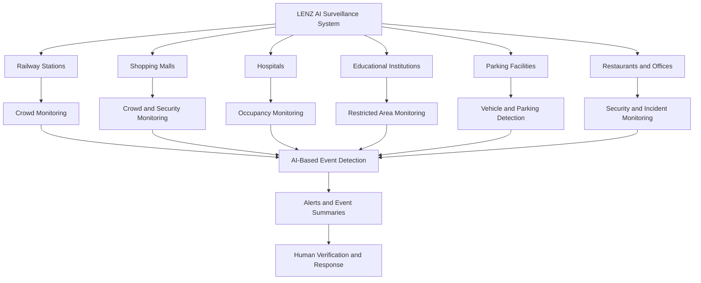
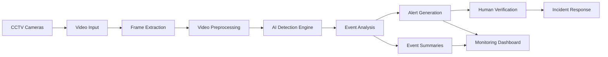
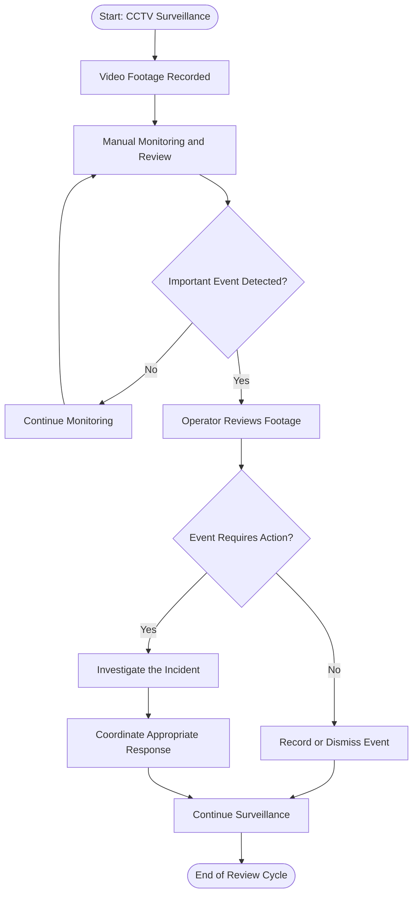
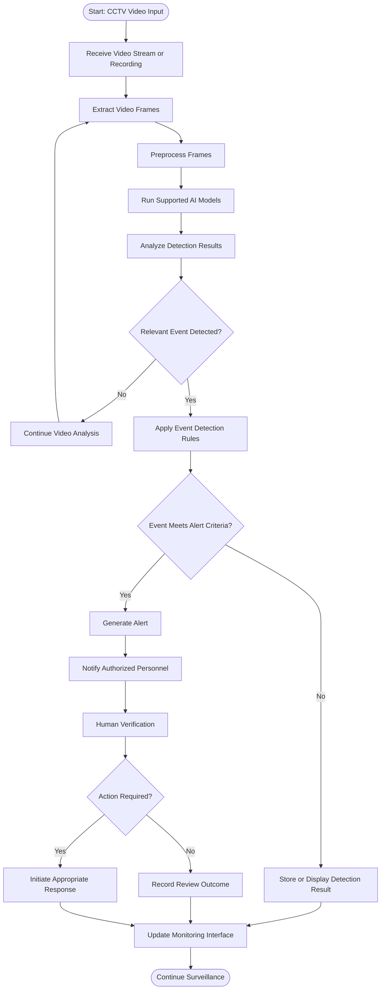

# Lenz — AI-Powered Intelligent Video Surveillance

  <strong>Turning Every Camera into an Intelligent Guardian</strong>

  Transforming ordinary CCTV cameras into intelligent,
  AI-powered monitoring systems for safer and smarter environments.

  🚨 Threat Detection • 👥 Crowd Monitoring • 🚗 Parking Intelligence • 📊 Real-Time Insights

---

## Table of Contents

1. [Problem Statement](#1-problem-statement)
2. [Problem Understanding & Approach](#2-problem-understanding--approach)
3. [Proposed Solution](#3-proposed-solution)
4. [Key Features](#4-key-features)
5. [System Architecture](#5-system-architecture)
6. [System Workflow](#6-system-workflow)
7. [AI & Computer Vision Approach](#7-ai--computer-vision-approach)
8. [Technology Stack](#8-technology-stack)
9. [Database Design](#9-database-design)
10. [Dataset & Model Selection](#10-dataset--model-selection)
11. [API Documentation & Testing](#11-api-documentation--testing)
12. [Installation & Setup](#12-installation--setup)
13. [End-to-End Workflow](#13-end-to-end-workflow)
14. [Demo & Screenshots](#14-demo--screenshots)
15. [Module-Wise Development](#15-module-wise-development)
16. [Team Roles & Responsibilities](#16-team-roles--responsibilities)
17. [Future Scope](#17-future-scope)
18. [Known Limitations](#18-known-limitations)
19. [Privacy & Responsible AI](#19-privacy--responsible-ai)
20. [Impact](#20-impact)

---

## 1. Problem Statement

### Problem Title

**AI-Powered Intelligent Video Surveillance & Real-Time Threat Detection**

### Problem Description

Millions of CCTV cameras are installed across restaurants, railway
stations, classrooms, hospitals, shopping malls, parking areas,
offices, and public streets.

These cameras continuously record video footage, but most surveillance
systems still depend heavily on human operators to monitor camera feeds
and identify important events.

With multiple cameras recording simultaneously, it becomes difficult
for security personnel to observe every feed continuously.
As a result, theft, suspicious activities, parking violations,
and overcrowded areas may go unnoticed until someone manually
reviews the footage or reports an incident.

Traditional CCTV systems primarily act as recording devices rather
than intelligent monitoring systems.

The problem is not the lack of cameras, but the lack of intelligence
in the information they capture.

Lenz aims to bridge this gap by using Artificial Intelligence (AI)
and Computer Vision to analyse video feeds, identify predefined
events, and generate actionable alerts for security personnel.

The goal is to transform existing camera infrastructure into
an intelligent monitoring system that helps people identify
potential problems faster and make informed decisions.

---

### Key Challenges

| Challenge | Description | Impact |
|---|---|---|
| **Continuous Manual Monitoring** | Security personnel must observe multiple camera feeds simultaneously. | Important incidents may be missed. |
| **Delayed Theft Detection** | Suspicious activities may remain unnoticed until footage is reviewed. | Delayed response and potential losses. |
| **Crowd Management** | Operators may struggle to estimate crowd density across multiple locations. | Overcrowding and delayed intervention. |
| **Parking Violations** | Unauthorized parking and occupied spaces may not be monitored efficiently. | Congestion and inefficient parking management. |
| **Information Overload** | Cameras generate large volumes of footage throughout the day. | Reviewing recordings consumes time and effort. |
| **Delayed Incident Response** | Conventional systems may require someone to notice an incident before action is taken. | Slower security response. |
| **Limited Actionable Insights** | Raw video footage does not automatically provide structured event summaries. | Difficult monitoring and decision-making. |
---

## 3. Target Users

The **Lenz AI Surveillance System** is designed for organizations that already use CCTV cameras and want to improve security monitoring, crowd management, and incident response through AI-powered video analysis.

### Target User Flowchart

### Project Objectives

| Parameter | Description |
|---|---|
| **Primary Objective** | Improve CCTV monitoring through AI-assisted video analysis and event detection. |
| **Stampede Prevention** | Estimate crowd density in supported camera views to assist with crowd management. |
| **Security Monitoring** | Identify predefined security-related events for human review. |
| **Occupancy Monitoring** | Help facility more efficiently and support faster, more informed responses. |

### Existing System Limitations vs Impact of LENZ AI

| Limitation in Existing Systems | Impact on Security Teams and Facility Managers |
|---|---|
| **Continuous manual CCTV monitoring** | Operators must watch multiple camera feeds, increasing workload and the possibility of missing important events. |
| **Delayed incident detection** | Suspicious activities may be noticed only after an incident occurs or someone reports it. |
| **Manual crowd monitoring** | Estimating crowd density manually makes it difficult to identify overcrowding early in supported camera views. |
| **Manual parking surveillance** | Parking violations may go unnoticed when staff cannot continuously monitor every parking area. |
| **Time-consuming footage review** | Security personnel may need to search long video recordings to locate a specific incident. |
| **Limited real-time operational insights** | Facility managers may lack timely information about crowd levels, occupancy, and predefined security events. |
| **Fragmented incident response** | Staff may need to switch between camera feeds, reports, and communication channels to investigate an incident. |

### How LENZ AI Improves the Existing System

| LENZ AI Capability | Expected Operational Benefit |
|---|---|
| **AI-Assisted Threat Detection** | Identifies predefined suspicious activities or security-related events supported by the selected model. |
| **Crowd Density Estimation** | Helps operators monitor crowd levels and identify potential overcrowding in supported camera views. |
| **Parking Violation Detection** | Detects predefined parking violations when the camera view and detection model support the relevant conditions. |
| **Event-Based Video Summaries** | Helps operators locate relevant footage without manually reviewing every recording. |
| **Automated Alerts** | Notifies authorized personnel when configured detection rules are triggered. |
| **Human Verification** | Allows security personnel to review alerts before taking action. |
| **Centralized Monitoring** | Helps operators manage supported camera feeds, alerts, and incident information from one interface. |

## 1. System Workflow

LENZ transforms conventional CCTV infrastructure into an AI-assisted surveillance system. It processes supported camera feeds, analyzes video frames, detects predefined events, and provides alerts and summaries to help security personnel make informed decisions.

### System Workflow Diagram

### System Workflow Explanation

| Step | Component | Description |
|---|---|---|
| 1 | CCTV Cameras | Uses existing camera infrastructure as the video source. |
| 2 | Video Input | Receives video streams or recorded footage, depending on the integration. |
| 3 | Frame Extraction | Extracts individual frames or selected video segments for analysis. |
| 4 | Video Preprocessing | Prepares frames for analysis through resizing, format conversion, and other required operations. |
| 5 | AI Detection Engine | Applies supported computer vision models to identify relevant objects, activities, or events. |
| 6 | Event Analysis | Evaluates model outputs against configured detection rules. |
| 7 | Alert Generation | Creates notifications when configured event conditions are satisfied. |
| 8 | Human Verification | Enables authorized personnel to review alerts and assess their context. |
| 9 | Incident Response | Supports appropriate follow-up actions by responsible security personnel. |
| 10 | Event Summaries | Organizes detected events to help operators locate relevant footage. |
| 11 | Monitoring Dashboard | Presents available alerts, detection results, and event information in a centralized interface. |

**Note:** Actual camera connectivity, live-stream processing, alert delivery, and dashboard integrations depend on the implemented modules and deployment configuration.

---

## 2. Problem Understanding & Approach

### Root Cause Analysis

Traditional CCTV systems primarily record video footage. Security personnel must often monitor multiple camera feeds, identify important events, and search recordings manually. LENZ aims to reduce this operational burden through AI-assisted video analysis.

| Problem Area | Root Cause | Impact on Security Teams |
|---|---|---|
| Manual Camera Monitoring | Multiple camera feeds require continuous human attention. | Important events may be missed during prolonged monitoring. |
| Delayed Incident Detection | Recorded footage may require manual inspection before an incident is recognized. | Investigation and response may be delayed. |
| Limited Crowd Visibility | Crowd levels are difficult to estimate consistently through manual observation. | Potential overcrowding may not be recognized early. |
| Manual Parking Monitoring | Staff must observe parking areas to identify predefined violations. | Parking violations may remain unnoticed. |
| Time-Consuming Footage Review | Locating a particular incident requires searching recordings. | Investigation takes additional time and effort. |
| Lack of Event-Based Insights | Traditional recording systems do not inherently provide AI-generated event summaries. | Operators may struggle to locate relevant video segments quickly. |
| Fragmented Security Operations | Camera footage, alerts, and incident records may be handled separately. | Coordination and investigation can become less efficient. |

### Problem Analysis Flowchart

### Understanding the Problem Flowchart

1. **CCTV Surveillance:** Cameras record activities in the monitored environment.
2. **Manual Monitoring:** Security personnel observe the available footage.
3. **Event Detection:** An operator identifies a potentially important event.
4. **Event Verification:** The operator checks whether the event requires further investigation.
5. **Incident Investigation:** Relevant footage is reviewed to understand what happened.
6. **Response Coordination:** Personnel take appropriate action based on the verified situation.

The central problem is that traditional CCTV recording alone does not guarantee automated event detection or timely alerts.

### Existing System vs Proposed LENZ Solution

| Existing System | Proposed LENZ Improvement |
|---|---|
| Operators manually monitor camera feeds. | AI-assisted analysis helps identify supported events. |
| Incidents may be identified after manual review. | Configured detection rules can generate alerts when supported events are detected. |
| Crowd levels are estimated manually. | Computer vision can estimate crowd density in supported camera views. |
| Parking violations require manual observation. | AI-assisted detection can identify predefined parking violations where supported. |
| Large volumes of footage require manual searching. | Event-based summaries help operators locate relevant footage. |
| Security teams investigate reports manually. | Detection results and alerts can support a more organized investigation workflow. |

---

## 3. Solution Strategy

LENZ uses an AI-assisted video analysis pipeline to convert CCTV footage into useful event information. Its goal is to support security teams with detection, monitoring, and investigation rather than replace human judgment.

### Solution Workflow Diagram

### Solution Strategy Explanation

#### 1. Video Input and Ingestion

Receive video from supported CCTV cameras or recorded video files.

**Objective:**
- Use existing surveillance infrastructure where compatible.
- Accept supported video formats and streams.
- Establish a consistent input pipeline for further analysis.

#### 2. Frame Extraction and Preprocessing

Extract frames or selected video segments and prepare them for AI inference.

**Objective:**
- Standardize frame dimensions and formats.
- Handle supported input resolutions.
- Prepare video data for the selected computer vision models.

#### 3. AI-Assisted Event Detection

Apply suitable computer vision models to identify events supported by the implementation.

Potential capabilities include:

- Suspicious activity detection using supported models and predefined rules.
- Crowd density estimation.
- Vehicle and parking violation detection.
- Identification of relevant objects or activities.

**Important:** Suspicious activity is context-dependent. A model detecting an object or movement should not automatically be treated as proof of criminal activity.

#### 4. Event Analysis and Rule Evaluation

Evaluate the detection results against configured rules.

**Objective:**
- Filter detections according to supported conditions.
- Reduce unnecessary notifications through appropriate filtering.
- Associate detections with the relevant camera and time when that information is available.

#### 5. Alert Generation

Generate alerts when configured detection criteria are satisfied.

An alert may include:

- Event category.
- Camera identifier.
- Timestamp.
- Detection information.
- A reference to relevant footage, if available.

Alert delivery channels depend on the implemented notification system.

#### 6. Human Verification

Allow authorized security personnel to examine the detection results and available footage.

**Objective:**
- Verify whether an alert represents a genuine concern.
- Reduce the risk of acting on false detections.
- Provide context before initiating a response.

#### 7. Event Summaries and Investigation Support

Organize relevant event information to help operators find important footage.

**Objective:**
- Reduce unnecessary manual searching.
- Support incident investigation.
- Make available event information easier to review.

#### 8. Monitoring Dashboard

Present available detections, alerts, and event information through the monitoring interface.

**Objective:**
- Improve visibility into detected events.
- Help operators prioritize alerts.
- Support coordination between security personnel and facility managers.

---

### Solution Components and Expected Benefits

| Component | Function | Expected Benefit |
|---|---|---|
| Video Ingestion | Receives supported camera streams or video files. | Provides a common entry point for video analysis. |
| Frame Processing | Extracts and prepares video frames. | Enables consistent model input. |
| AI Detection Engine | Identifies supported objects, activities, or events. | Assists operators in recognizing relevant events. |
| Crowd Monitoring | Estimates crowd density in supported views. | Helps identify potential overcrowding. |
| Parking Intelligence | Detects predefined parking violations where supported. | Supports parking-area monitoring. |
| Event Analysis | Evaluates detection results against configured rules. | Helps filter and categorize relevant events. |
| Alert System | Generates notifications for qualifying events. | Supports timely investigation. |
| Event Summarization | Organizes detected events and relevant footage references. | Helps operators locate incidents more efficiently. |
| Human Verification | Allows personnel to review detections. | Supports informed decision-making. |
| Monitoring Dashboard | Displays available event information and alerts. | Improves centralized visibility. |

### Expected Outcome

LENZ aims to make existing CCTV infrastructure more useful by adding AI-assisted detection, event-based monitoring, and investigation support.

The expected operational benefits include:

- Less dependence on continuous manual observation.
- Faster identification of supported events.
- Improved visibility into crowd conditions and parking violations.
- Easier access to relevant footage.
- More structured alert review and incident investigation.

**Evaluation note:** These are intended benefits, not measured results. Actual detection accuracy, alert latency, false-positive rates, and operational improvements must be established through testing with representative video footage.
