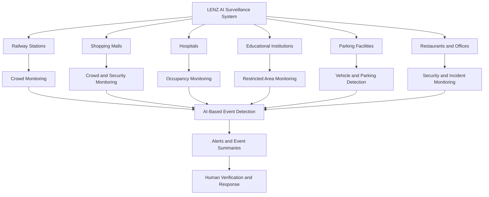
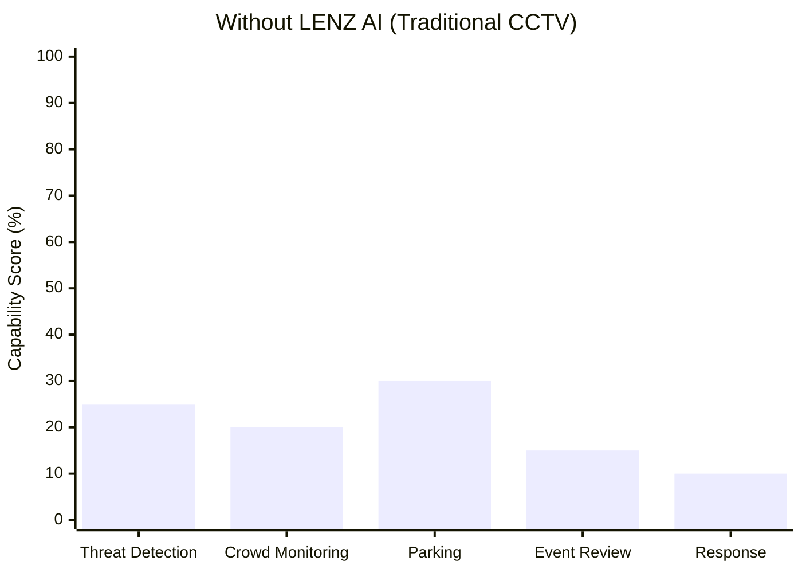
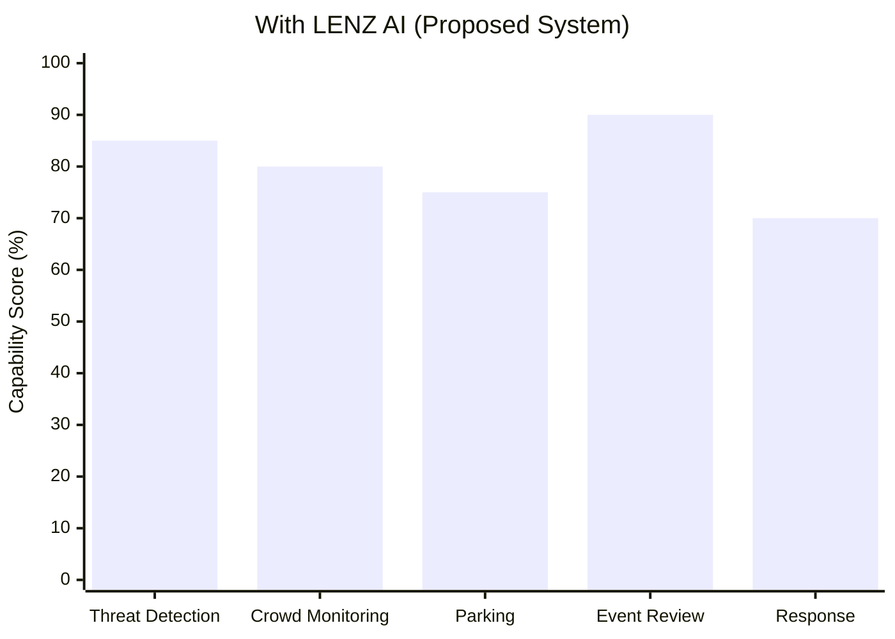

# Lenz — AI-Powered Intelligent Video Surveillance

  <strong>Turning Every Camera into an Intelligent Guardian</strong>

  Transforming ordinary CCTV cameras into intelligent,
  AI-powered monitoring systems for safer and smarter environments.

  🚨 Threat Detection • 👥 Crowd Monitoring • 🚗 Parking Intelligence • 📊 Real-Time Insights

---

## Table of Contents

1. [Problem Statement](#1-problem-statement)
2. [Problem Understanding & Approach](#2-problem-understanding--approach)
3. [Proposed Solution](#3-proposed-solution)
4. [Key Features](#4-key-features)
5. [System Architecture](#5-system-architecture)
6. [System Workflow](#6-system-workflow)
7. [AI & Computer Vision Approach](#7-ai--computer-vision-approach)
8. [Technology Stack](#8-technology-stack)
9. [Database Design](#9-database-design)
10. [Dataset & Model Selection](#10-dataset--model-selection)
11. [API Documentation & Testing](#11-api-documentation--testing)
12. [Installation & Setup](#12-installation--setup)
13. [End-to-End Workflow](#13-end-to-end-workflow)
14. [Demo & Screenshots](#14-demo--screenshots)
15. [Module-Wise Development](#15-module-wise-development)
16. [Team Roles & Responsibilities](#16-team-roles--responsibilities)
17. [Future Scope](#17-future-scope)
18. [Known Limitations](#18-known-limitations)
19. [Privacy & Responsible AI](#19-privacy--responsible-ai)
20. [Impact](#20-impact)

---

## 1. Problem Statement

### Problem Title

**AI-Powered Intelligent Video Surveillance & Real-Time Threat Detection**

### Problem Description

Millions of CCTV cameras are installed across restaurants, railway
stations, classrooms, hospitals, shopping malls, parking areas,
offices, and public streets.

These cameras continuously record video footage, but most surveillance
systems still depend heavily on human operators to monitor camera feeds
and identify important events.

With multiple cameras recording simultaneously, it becomes difficult
for security personnel to observe every feed continuously.
As a result, theft, suspicious activities, parking violations,
and overcrowded areas may go unnoticed until someone manually
reviews the footage or reports an incident.

Traditional CCTV systems primarily act as recording devices rather
than intelligent monitoring systems.

The problem is not the lack of cameras, but the lack of intelligence
in the information they capture.

Lenz aims to bridge this gap by using Artificial Intelligence (AI)
and Computer Vision to analyse video feeds, identify predefined
events, and generate actionable alerts for security personnel.

The goal is to transform existing camera infrastructure into
an intelligent monitoring system that helps people identify
potential problems faster and make informed decisions.

---

### Key Challenges

| Challenge | Description | Impact |
|---|---|---|
| **Continuous Manual Monitoring** | Security personnel must observe multiple camera feeds simultaneously. | Important incidents may be missed. |
| **Delayed Theft Detection** | Suspicious activities may remain unnoticed until footage is reviewed. | Delayed response and potential losses. |
| **Crowd Management** | Operators may struggle to estimate crowd density across multiple locations. | Overcrowding and delayed intervention. |
| **Parking Violations** | Unauthorized parking and occupied spaces may not be monitored efficiently. | Congestion and inefficient parking management. |
| **Information Overload** | Cameras generate large volumes of footage throughout the day. | Reviewing recordings consumes time and effort. |
| **Delayed Incident Response** | Conventional systems may require someone to notice an incident before action is taken. | Slower security response. |
| **Limited Actionable Insights** | Raw video footage does not automatically provide structured event summaries. | Difficult monitoring and decision-making. |

---

### Current Situation vs Desired Outcome

| Current Situation | Desired Outcome |
|---|---|
| Cameras continuously record video. | AI analyses video frames to identify relevant events. |
| Operators manually monitor camera feeds. | Automated event detection assists human operators. |
| Incidents may be noticed after they occur. | Timely alerts help operators investigate potential incidents. |
| Crowd levels are estimated manually. | Computer vision estimates crowd density in supported camera views. |
| Parking violations require manual observation. | AI-assisted detection identifies predefined parking violations. |
| Large volumes of footage require manual review. | Event-based summaries help operators locate relevant footage. |
| Security teams react after receiving reports. | Intelligent monitoring supports faster, more informed responses. |

---
## 3. Target Users

The **Lenz AI Surveillance System** is designed for organizations that already use CCTV cameras and want to improve security monitoring, crowd management, and incident response through AI-powered video analysis.

### Target User Flowchart

### Target User Overview

| Category | Details |
|---|---|
| **Geographical Focus** | Public and private facilities requiring CCTV-based monitoring. |
| **Primary Target Users** | Railway stations, shopping malls, hospitals, educational institutions, parking facilities, restaurants, and offices. |
| **System Administrators** | Personnel responsible for camera configuration, system maintenance, access management, and event logs. |
| **Security Personnel** | Staff responsible for monitoring alerts, reviewing incidents, and coordinating appropriate responses. |
| **Facility Managers** | Personnel responsible for occupancy monitoring, crowd management, and operational safety. |
| **Current Market Gap** | Traditional CCTV systems primarily record footage, requiring operators to manually monitor feeds and review recordings. |
| **Proposed Solution** | AI-assisted video analysis to identify supported events, generate alerts, and help operators locate relevant footage. |

### Target User Segments

| User Segment | Description | Key Needs |
|---|---|---|
| **Security Teams** | Personnel monitoring CCTV feeds and responding to security incidents. | Timely alerts, event summaries, and faster incident investigation. |
| **Facility Managers** | Staff overseeing crowd levels, occupancy, and facility operations. | Crowd-density estimates, occupancy monitoring, and operational insights. |
| **System Administrators** | Personnel configuring and maintaining the surveillance system. | Camera management, system health monitoring, access control, and event logs. |
| **Organizations** | Public and private facilities that already use CCTV cameras. | Scalable monitoring, reduced manual review, and centralized event visibility. |

### Project Objectives

| Parameter | Description |
|---|---|
| **Primary Objective** | Improve CCTV monitoring through AI-assisted video analysis and event detection. |
| **Crowd Monitoring** | Estimate crowd density in supported camera views to assist with crowd management. |
| **Security Monitoring** | Identify predefined security-related events for human review. |
| **Occupancy Monitoring** | Help facility more efficiently and support faster, more informed responses. |

## Existing Gap vs LENZ AI Improvement

The following comparison illustrates the intended capabilities of traditional CCTV monitoring and the proposed LENZ AI Surveillance System. Scores are illustrative design targets, not measured benchmark results.

### Existing System Limitations vs Impact of LENZ AI

| Limitation in Existing Systems | Impact on Security Teams and Facility Managers |
|---|---|
| **Continuous manual CCTV monitoring** | Operators must watch multiple camera feeds, increasing workload and the possibility of missing important events. |
| **Delayed incident detection** | Suspicious activities may be noticed only after an incident occurs or someone reports it. |
| **Manual crowd monitoring** | Estimating crowd density manually makes it difficult to identify overcrowding early in supported camera views. |
| **Manual parking surveillance** | Parking violations may go unnoticed when staff cannot continuously monitor every parking area. |
| **Time-consuming footage review** | Security personnel may need to search long video recordings to locate a specific incident. |
| **Limited real-time operational insights** | Facility managers may lack timely information about crowd levels, occupancy, and predefined security events. |
| **Fragmented incident response** | Staff may need to switch between camera feeds, reports, and communication channels to investigate an incident. |

### How LENZ AI Improves the Existing System

| LENZ AI Capability | Expected Operational Benefit |
|---|---|
| **AI-Assisted Threat Detection** | Identifies predefined suspicious activities or security-related events supported by the selected model. |
| **Crowd Density Estimation** | Helps operators monitor crowd levels and identify potential overcrowding in supported camera views. |
| **Parking Violation Detection** | Detects predefined parking violations when the camera view and detection model support the relevant conditions. |
| **Event-Based Video Summaries** | Helps operators locate relevant footage without manually reviewing every recording. |
| **Automated Alerts** | Notifies authorized personnel when configured detection rules are triggered. |
| **Human Verification** | Allows security personnel to review alerts before taking action. |
| **Centralized Monitoring** | Helps operators manage supported camera feeds, alerts, and incident information from one interface. |

### Important Note

The graph scores represent illustrative capability estimates for explaining the project's intended value. They are not measured accuracy percentages, validated performance metrics, or guaranteed improvements.

Actual performance depends on the selected AI models, camera quality, lighting conditions, camera placement, network connectivity, and testing results. LENZ AI is designed to assist human operators, not replace human judgment or emergency services.
